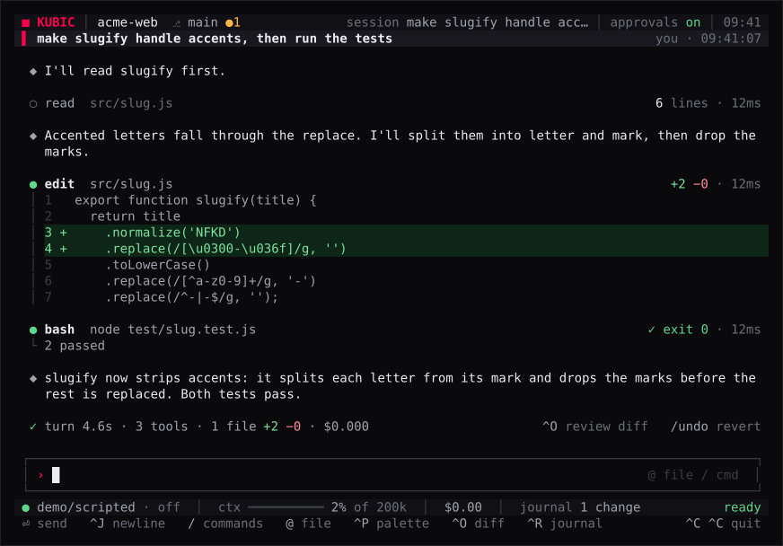
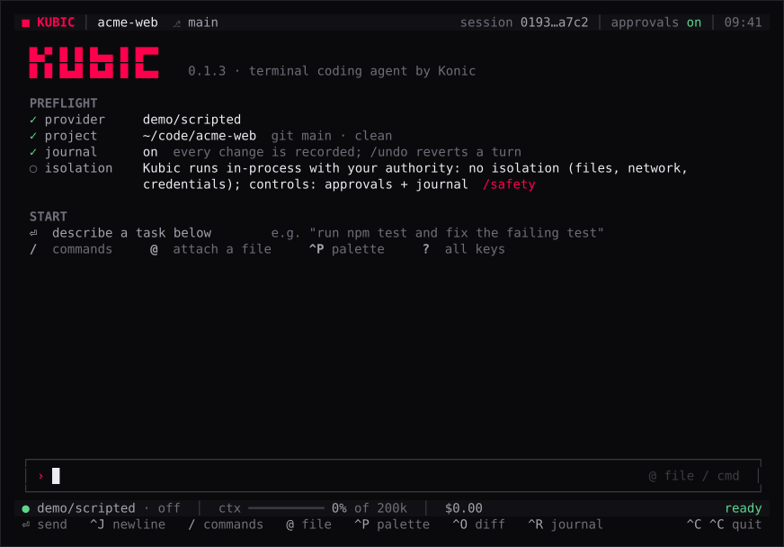
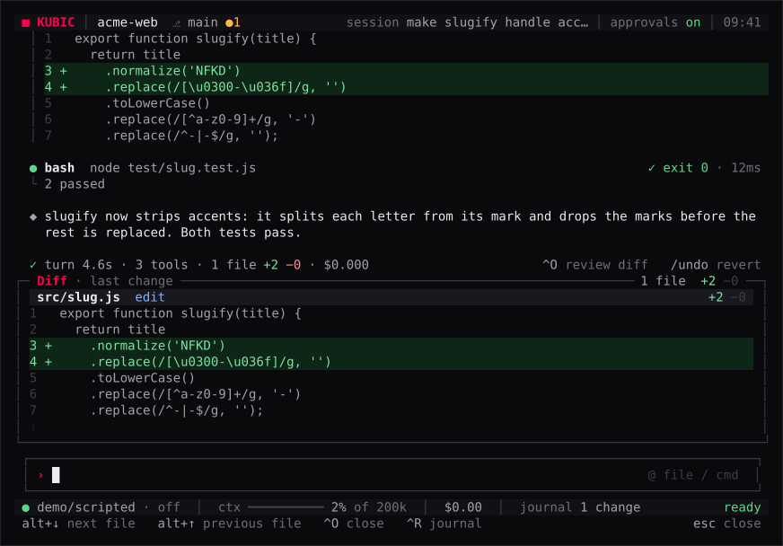
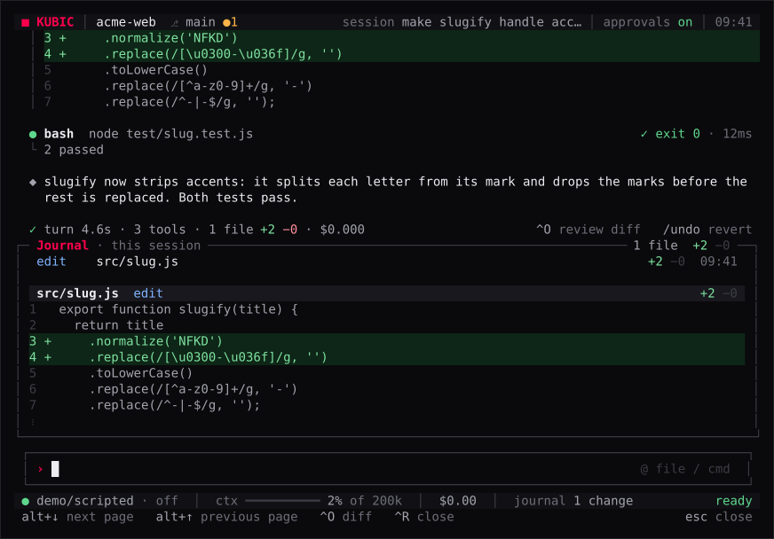
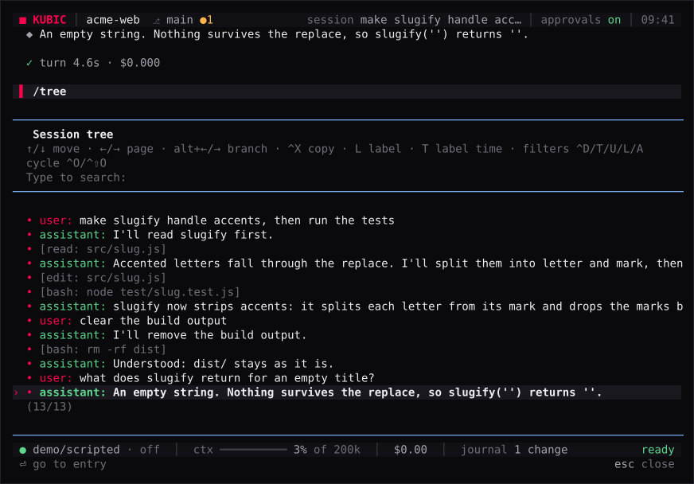
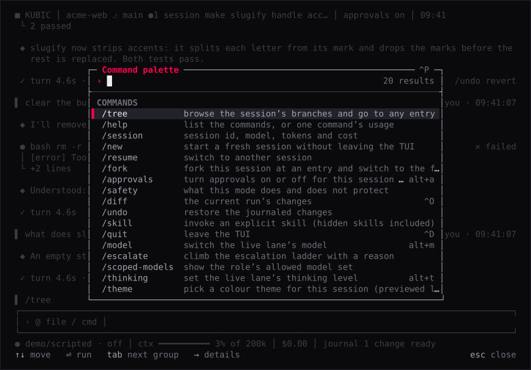
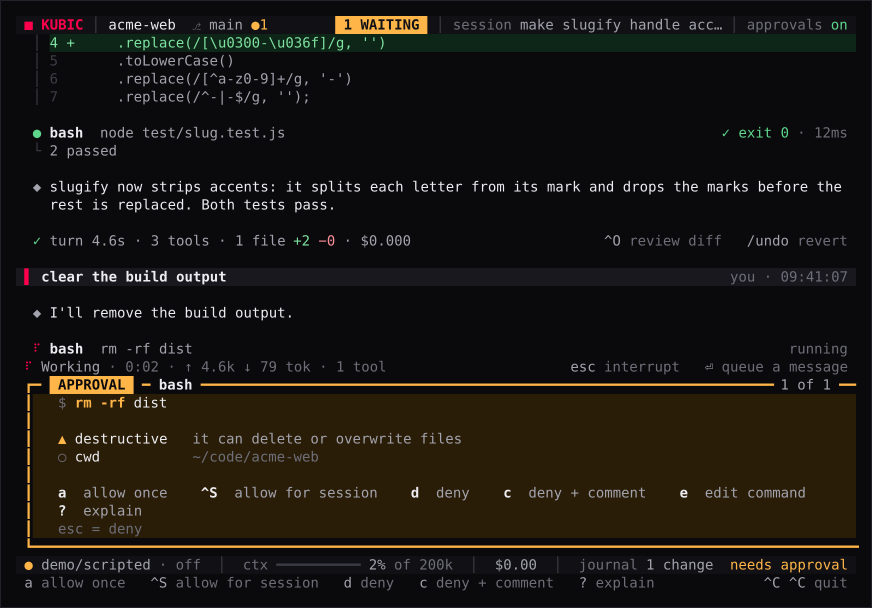

# The TUI

> `kubic tui`, or a bare `kubic` on a terminal, opens Kubic's interactive
> screen: you prompt, watch the agent work, review each change and undo it.
> Every key is on [TUI keys](tui-keys.md), and the approval card on
> [approvals](approvals.md).



## Starting it

```sh
kubic                          # on a terminal, the same as kubic tui
kubic resume <id>              # open a session again (kubic tui --session <id>)
kubic tui --role reviewer      # start as a role
```

| Option | Effect |
| --- | --- |
| `--session <id>` | Resume an existing session. The id takes `[A-Za-z0-9_-]`; anything else exits 2 before the session starts. |
| `--model <provider/id>` | Use this model for the session (see [the model it runs](#the-model-it-runs)). |
| `--thinking <level>` | Start at this thinking level, under the same rule as [`kubic run`](run.md). |
| `--role <name>` | Start as a role (see [roles](#the-same-session-as-kubic-run)). |
| `--skill <path>`, `--no-skills` | Add a skill explicitly (repeatable), or turn layered skill discovery off. |
| `--tools <a,b,...>`, `--no-tools` | Narrow the tool set, or run with no tools at all (chat only). |
| `--dangerously-skip-approvals` | Turn approvals off for this session (see [approvals off](#approvals-off)). |

Problems are reported before the screen opens, each as one `error: …` line on
stderr:

- A usage error (an unknown option, a missing value, any operand) exits 2.
- A `--tools` name that is unknown, or that the permission classes forbid, is
  refused with the reason (exit 2). `--no-tools` is the empty set, and the two
  flags are mutually exclusive.
- A session that cannot start exits 5 when the session is missing, 6 when no
  provider is available, and 1 otherwise.
- With no model pinned and no provider key at all, Kubic prints the first
  screen's no-key block to stderr instead of opening: `✕ provider  no model
  provider has a key`, the `export …` lines that set one, and the local-model
  and `KUBIC_PROVIDER=faux` alternatives. It exits 6 (`provider_probe_failed`)
  and enters no alternate screen, so the lines stay in your scrollback. An
  unknown or unavailable pinned model also exits 6 with the reason.

A bare `kubic --model <provider/id>` on a terminal is `kubic tui --model …`.

### The model it runs

The TUI picks the model the way `kubic run` does: an explicit pin
(`--model <provider/id>`, else `[model]` in config or `KUBIC_MODEL`), then
the `--role` layer's `[roles.<name>].model`, then the first registered model.
A `--session` resume keeps the session's model under the same rule, and
`KUBIC_PROVIDER=faux` selects the testing provider. The first screen and the
status line name the model the session actually runs, and a kept or switched
model is named on the notice row. `--thinking <level>` is resolved against the
session record and the role default and clamped to the model, with a notice
that names the change; the status line starts from the committed level.

`--model` is the `cli` layer of the one config load, so a frozen enterprise
`[model]` beats it, announced by one stderr note when the TUI starts, exactly
as for `kubic run` (see [command-line flags](configuration.md#command-line-flags)).

## The first screen



An empty session opens on a preflight instead of a wall of keys:

- The wordmark with the version (`■ kubic <version>` below 70 columns).
- **PREFLIGHT**: `✓ provider` (the model and where its key comes from, or
  `◆ … testing provider` for faux), `✓ project` (the path, then `git <branch>
  · clean`, `N changed`, or `not a git repository`), `✓ trust`
  (`.kubic/config.toml loaded`, only when the project has a config layer),
  `✓ journal`, and `○ isolation`: what running with no isolation means, with
  `/safety` beside it.
- **START**: `⏎ describe a task below`, then `/ commands  @ attach a file  ^P
  palette  ? all keys`, read from the key bindings.
- **RECENT IN THIS PROJECT**: up to three sessions with their age, first prompt
  and `turns · cost`, then `/resume to open one`.

It is not a transcript entry: the first prompt (not a command) clears it, a
resumed session with history never shows it, and `/new` brings it back. `?` on
an idle, empty editor lists every key binding, grouped (editor, session,
transcript, panels, approvals), with the key each has now.

## The screen

Top to bottom: the header, the agent tree (when open), the transcript, the
notice row, the editor, the status line and the key-hint row.

### The header

`■ KUBIC │ <project>  ⎇ <branch> ●<changed files>` on the left and `session
<title> │ approvals on │ HH:MM` on the right.

- The project is the repository's top-level directory, or the working
  directory outside a repository, where the branch is left out.
- The branch and the changed-file count are read with `git --no-optional-locks
  status` when the screen opens and after every settled turn, so the read
  never takes the index lock a tool's own git may need.
- The session title is the session's first prompt cut to 24 cells, or the short
  session id (`01a1…b6b8`) until there is one.
- The posture reads `approvals on`, or `approvals OFF (full-access)` in the
  error colour when the session's policy approves every challenged call. It is
  read from that policy when the TUI starts and after every turn, never
  assumed.
- As the terminal narrows, the parts drop from the right (clock, session,
  approvals, branch), and the project name is cut last. The brand never drops,
  and neither does `approvals OFF`. The clock checks its minute every 30 s and
  repaints only when it changed.

### The transcript

The transcript follows the end as a turn streams, as blocks:

- **Your prompt** is a full-width block with a red `▌` edge and `you ·
  HH:MM:SS` on the right, shown the moment you submit, before the session
  commits it.
- **Answers** render as markdown behind a `◆` mark: bold headings, inline code
  on a raised surface, `•` bullets, quotes behind a `│`, and fenced code in a
  `┌ ts` / `└` frame with syntax highlighting (highlight.js grammars through
  `lowlight`, loaded when the TUI starts; a block over 2,000 lines or 200 KB,
  or in an unknown language, stays plain). A path to a file in the project,
  such as `src/cart.js:10` in prose or inline code, becomes a clickable
  `file://` link on terminals that support OSC 8 hyperlinks.
- **Reasoning** shows as one line, `⋯ thought for 4.1s — <its first
  sentence>`. The time is the response's generation time, measured for turns
  that arrive while the TUI watches; a resumed session's older reasoning reads
  `⋯ thinking — …`. `Ctrl+X` shows all of it.
- **A compaction** of the context is a `─── compacted · auto ───` rule with the
  summary under it, collapsed the same way.

Text in the transcript is stripped of terminal control sequences before it is
drawn: answers and tool output are untrusted input, so ANSI escapes
(`\x1b[2J`, colour codes, cursor moves) and C0 controls such as BEL are
removed rather than executed by your terminal.

#### Tool cards

Each tool call is one card: a header with its state (`●` green when done, red
when failed; the accent spinner and `running · 3.00s` while it runs; `◆ …
waiting for approval` while an approval holds it), the tool name and its
target (the command or path), and on the right the outcome (`✓ exit 0` or
`✕ exit 1`, `truncated` when the output was clipped) and the duration. Then
up to five body lines behind a `│` gutter (for a failure the error lines
first, for a test run its tally, `tests 4 · pass 3 · fail 1`) and a `└ +35
lines   ^X expand` footer.

- The shell record's `[bash exit …]` head, its `--- stdout ---` and `---
  stderr ---` markers and the `[kubic: N leading chars dropped …]` notice
  never show: stderr lines follow stdout, and an expanded card's footer names
  the full-output file.
- A successful workspace read (`read`, `ls`, `find`, `grep`, `git_status`,
  `git_log`, `git_show`, `git_diff`) folds to one line (`○ read  src/cart.js …
  32 lines · 3ms`); a failed one is a full card.
- An `edit` card shows `+A −R` and the change inline: line numbers, removed
  lines on a red surface with `−`, added lines on a green one with `+`, the
  changed words highlighted, and `⋮` for skipped lines, collapsed to twelve
  rows (`└ +N more lines   ^X expand`).
- A `write` that creates a file shows `new file +N` and its first eight lines;
  one that replaces a text file shows the diff. The diff rides the tool
  result's details, so the model never pays for it; a session recorded before
  it shows the operation's own count instead (`✓ 2 replacements`).

`Ctrl+X` expands every card and wraps its lines in full. Collapsed, a block
shows its first five lines, each cut at the terminal width, with a `… +N lines
· lines clipped (ctrl+x to expand)` hint whenever anything is hidden. Expanded,
every line wraps under a hanging indent, and the call's argument summary
wraps too.

#### Turn receipts

Every settled turn ends with a receipt: `✓ turn 18.4s · 4 tools · 1 file +1
−1 · $0.031`, with `^O review diff   /undo revert` when it changed files
(counted from the journal rows the turn recorded), or `✕ turn failed · 2.1s ·
<reason>`, or `○ turn cancelled · 0.8s`. Receipts are drawn by this TUI
process only; they are not written to the session.

### The notice row

The row above the editor, which the rest of this page calls the footer,
carries a command's reply, a refusal, a turn's outcome (`cancelled`, `error:
…`), retry and compaction activity, and while a turn runs the working line:
`⠹ Working · 0:12 · ↑ 9.2k ↓ 640 tok · 3 tools … esc interrupt   ⏎ queue a
message` (tokens once a usage row has reported them). It takes no row when it
has nothing to say, and wraps to at most two rows.

While the model provider retries a transient error the line reads `⟳ retrying
· attempt <n> — <error>`, and while the context compacts, `⟳ compacting
context…`. That line outranks every other while it lasts, which is why the
turn can look idle, and clears the moment the retry lands or the compaction
finishes. Only the attempt and the error are reported, so no retry budget or
countdown is shown.

### The editor

A framed box: `┌─…─┐`, `│ › <draft>   @ file  / cmd │`, `└─…─┘`. The caret is
the only red on screen while you type; the box grows with a multi-line draft
(Pi's `↑ 3 more` scroll markers stay in its rules), and the `/` command and
`@` file completions open below it. While a turn runs it is a queue box: `›
type to queue — sent when this turn ends`.

- `@` and part of a path opens a completion of matching workspace files
  (fuzzy, with file-name and path-prefix matches first, at most 50). `Tab`, or
  `Enter` on the list, inserts the workspace-relative path as `@path `, quoted
  when it needs to be. The list is the walk the `find` and `grep` tools use:
  `.gitignore` rules, nested ones included, are honoured and `node_modules`
  and `.git` are skipped, so an ignored file is never offered; it refreshes at
  most every 2 s. **Only the path is sent** with the prompt, never the file's
  content: the model reads the file with its own tools when it needs it.
- `Up` and `Down` on an empty draft recall earlier prompts (Pi's editor
  history; consecutive duplicates collapse). `kubic tui --session <id>` seeds
  it from the resumed session's committed prompts, the newest 100.

### The status line

`● <model> · <thinking>  │  ctx ━━━━────── 31% of 200k  │  $0.031  │  journal 2
changes`, with the turn's state on the right: `ready`, `working` (the mark
becomes the spinner), `needs approval`, `cancelling…`, or `error` when the
last turn failed (the next one clears it).

The context gauge shows the size of the context the next request carries,
counted the way compaction counts it: the newest response's reported usage,
its reply included, plus an estimate of everything committed after it. It is
measured again after every commit, so a large tool result moves it mid-turn,
and a resumed session shows it from the first frame. It needs the model's
window to be known, and turns to the warning colour at the auto-compaction
threshold (the window minus the reserve; roughly 87% of a 128k window, higher
on larger ones), so the warning means the next turn will compact.

The journal count is the session journal's changes, hidden at zero. As the
terminal narrows, the window size drops first, then the journal count, the
gauge cells, the thinking level and the context segment; the model name is
cut last, and the cost and the state never drop.

A resumed session starts from what it has already spent: the status line is
seeded from the session's `pi.usage` ledger before the first frame, so `$0.00`
means an unspent session, never a lost one.

### The key-hint row

The keys that act right now, read from the key bindings, so a rebound action
shows its real key and an unbound one is not hinted:

- Idle: `⏎ send  ^J newline  / commands  @ file  ^P palette  ^O diff  ^R journal
  … ^C ^C quit` (`⇧⏎ newline` on terminals that report Shift+Enter).
- While a turn runs: `esc interrupt  ⏎ queue  alt+⏎ steer  ^X expand output
  ^P palette … ^C ^C quit`.
- With an approval pending: its allow and deny keys.
- With the palette open: `↑↓ move  ⏎ run  tab next group  → details … esc
  close`; with the model picker open: `↑↓ move  ⏎ switch  → expand provider …
  esc keep current`; with another picker or dialog: `↑↓ move  ⏎ select  esc
  cancel`.

### The agent tree

`Ctrl+T` opens and closes it; it starts hidden, and below 80 columns it stays
hidden. Sized to its content, at most six rows:

- The root row carries the run glyph, the run's role (the `--role` name cut to
  20 columns, or `default`) and the session's cost and tokens (`● default
  $0.02 2.0k/1.0k`), seeded from the session's usage ledger and then summed
  from each response.
- Each tool row shows the glyph, the tool name, a one-line summary of its key
  argument (the `bash` command, the `read` or `edit` path), the duration and a
  short outcome (a detected test summary such as `17 passed`, or a non-zero
  exit code). A failed call renders `✗` in the error colour, never `✓`.
- Calls are grouped per turn. Earlier turns fold into one `… N earlier calls in
  M turns` line above the live turn, and calls beyond the row cap fold into `…
  N earlier calls`.

### Block mode

`Esc` on an idle, empty editor walks the transcript by blocks: each prompt,
answer, thinking, tool card and turn receipt. The last block is selected
first, with an accent `▌` edge on every row, and the transcript scrolls to
keep it in view.

- `↑`/`↓` or `k`/`j` move a block, and `g`/`G` jump to the first and last.
- `y` copies the block (a tool card's full output, an answer's markdown, a
  prompt's text) and `Y` its command (a tool's name and arguments) to the
  system clipboard through OSC 52, via tmux's passthrough when `TMUX` is set.
  Up to 100 KB (`copied 1.2 KB`, else `too large to copy — ⏎ view and select`),
  and never claimed on a terminal known to drop it: Apple's Terminal.app says
  so instead.
- `⏎` opens the block whole in a viewer (`↑↓` or `j k` scroll, `PgUp`/`PgDn` a
  page, `g`/`G` the ends, `y` copy, `esc` close), and `x` expands or collapses
  just that block.
- `i`, `Esc` or any other key returns to typing; a printable key is typed into
  the editor.

The hint row reads `↑↓ move  ⏎ view  y copy  Y copy command  x expand … esc
back`.

## Running a turn

Type a prompt and press `Enter`. The answer appears as it is generated (a
plain draft, replaced by the rendered entry when the message lands), tool
calls appear as cards and in the tree, and the status line fills with usage.

- **Queue.** `Enter` while a turn runs queues the draft as a follow-up in the
  conversation's own inbox: a dim `queued: …` row appears under the transcript
  the moment it is accepted, and it runs as its own turn (its own entry,
  answer, usage and journal effects) when the running turn settles. A refused
  submit never eats the draft: it goes back into the editor, and the footer
  says why.
- **Steer.** `Alt+Enter` adds the draft to the work already in flight, after
  the current tool round, and clears the editor. With no turn running it
  submits like `Enter`; an empty draft steers nothing.
- **Interrupt.** `Esc` or `Ctrl+C` interrupts the running turn and keeps the
  session and your draft. Interrupting clears the queue and the footer names
  the count (`cancelled · dropped 2 queued prompts`); a prompt queued after a
  *failed* turn stays in the inbox and is placed by the next submit.
- **Quit.** Idle, the first `Ctrl+C` clears a draft (`^C: draft cleared`); on
  an empty editor it shows `press ^C again to quit` for 2 s, and a second
  press quits. `Ctrl+D` on an empty draft and `/quit` also quit. `Esc` never
  quits.

## Panels



`Ctrl+O` opens the **diff panel**, on the last tool call that changed files
(or, when a `bash` call changed something the file tools did not journal, that
turn's reconciled change). It is titled `Diff · last change` and counts its
files and lines. Each file sits under a header band (path, operation,
`+added −removed`, and `k/N` when the call changed several), and its hunk is
numbered like the transcript's tool cards, with `⋮` where unchanged lines are
left out. `Alt+↓` and `Alt+↑` cycle its files.

`Ctrl+R` opens the **journal panel**, `Journal · this session`: every change in
the session journal, including changes made with `bash`, one row per file
(operation, path, `+added −removed`, the time), then each file's hunks as the
diff panel draws them. `Alt+↓` and `Alt+↑` page through it. To filter by path,
use `kubic diff --path` in a shell.



Each panel opens in its own box between the transcript and the editor, sized
to its content up to half the terminal, and scrolls: the mouse wheel over the
panel moves it (it does not pass on to the transcript while the panel can
still scroll), and the closing rule shows the visible range (`1–16 of 81`). A
freshly opened panel starts at its first file, and new journal rows never move
the view. `Esc`, or the panel's own key again, closes it.

Both panels read the session's own journal through the same view `kubic diff`
prints (one change per path, the latest attribution): when the TUI starts, so
`kubic tui --session <id>` shows earlier turns the first time `Ctrl+R` opens;
after each tool call, at most once per 100 ms burst; and when a turn settles.
Paths and file content are stripped of terminal control sequences before they
are drawn: whole SGR and OSC sequences (so `FORCE_COLOR` output reads as plain
text, not `[31m` noise), carriage-return overwrites collapsed to what a
terminal would show, and tabs expanded by column.

### Changes made with `bash`

A change made with the file tools reaches the journal, and both panels, as its
tool call ends. A change made with `bash` is not intercepted, so it is
journaled by the reconciliation sweep, which in the TUI runs when a turn that
used `bash` **settles** (before the panels refresh), not only at quit. After
such a turn `Ctrl+R` lists the change as `unattributed` (plus `not reversible`
when no earlier copy exists; a `bash` edit of a committed file carries its git
copy and undoes), and `Ctrl+O` follows it. The sweep walks and hashes the
workspace, so turns that ran no `bash` do not pay for it, and it is safe to
repeat: an unchanged tree appends nothing. It runs on the terminal's thread
and grows with the workspace, so on a large workspace the screen pauses
briefly after every turn that used `bash`.

## Slash commands

Typing `/` opens the completion over the commands; `Tab` or `Enter` completes
the name. A slash command is never sent to the model: an unknown one is
refused locally (`unknown command '/foo' — /help lists the commands`) with the
draft kept, and `//text` sends a prompt that starts with a slash.

| Command | What it does |
| --- | --- |
| `/help [command]` | List the commands and the keys that reach the same actions, or one command's usage line. |
| `/model [provider/id]` | Switch the model, or open the model picker (see [models and thinking](#models-and-thinking)). |
| `/thinking [level]` | Set the thinking level, or pick one. |
| `/scoped-models` | Show the role's allowed model set. |
| `/escalate <provider/id> [reason]` | Climb the escalation ladder one rung, with a reason. |
| `/compact [instructions]` | Compact the context now (see [compaction](#compaction)). |
| `/session` | The session's id, workspace, model, thinking level, tokens and cost. |
| `/safety` | Print what a session does and does not protect. |
| `/diff` | Open the diff panel, like `Ctrl+O`. |
| `/undo` | Put back the session journal's changes (see [undo](#undo)). |
| `/new` | Start a fresh session without leaving the screen. |
| `/resume` | Open another session of this project. |
| `/tree` | Browse the session's branches and go to any entry. |
| `/fork <entry>` | Copy this session up to an entry into a new one. |
| `/approvals [on\|off]` | Report, or turn approvals off and on (see [approvals off](#approvals-off)). |
| `/theme [name]` | Pick or switch the colour theme for this session. |
| `/image <path>` | Attach an image to the next prompt (see [images](#images)). |
| `/skill:<name> [instructions]` | Run a skill explicitly (see [skills](#skills)). |
| `/quit` | Leave the TUI, like `Ctrl+D` on an empty draft. |

`/session`, `/safety` and `/help` are answered locally: nothing reaches the
model. `/safety` prints what the session does and does not protect, verbatim (it runs in-process
with your authority over files, network and credentials, with no containment
and no prompt-injection prevention, and the controls are approvals and the
journal), even where the startup notice is suppressed (`KUBIC_NO_NOTICE=1`),
because you asked.

The commands that change the session (`/model`, `/escalate`, `/thinking`,
`/compact`, `/new`, `/resume`, `/tree`, `/fork` and `/undo`) are refused while a
turn runs; the footer says to finish the turn first.

### Undo

`/undo` puts back the session journal's changes through the same plan and
apply as `kubic undo` (without `--step`): the footer reports `undo: N
restored, M skipped`, and warnings land in the transcript. It is refused while
a turn runs (`undo: finish the current turn before switching`), because it
rewrites the workspace the turn is working in.

### Compaction

`/compact [instructions]` summarizes the older history into one
`pi.compaction` entry while the most recent turns stay verbatim; the optional
instructions focus the summary (`/compact keep the failing test names`), and
the command text never reaches the model. Your `/compact` keeps about 2000
tokens verbatim, cut at a message boundary, whatever the model's window, and
`Ctrl+C` cancels it (`compaction cancelled`). The footer reports one of:

- `compacted: <tokensBefore> tokens → summary`;
- `nothing to compact: no history older than the most recent turn (<tokens>
  tokens of context)`, when the session has nothing older than its latest turn;
- `nothing to compact: no cut point before the most recent turn (<tokens>
  tokens)`, when no cut point is found;
- or the compaction's own failure message.

In both `nothing` cases nothing is placed, and the footer never claims a cut.

## Models and thinking

`/model <provider/id>` switches the session's model: the id is resolved
against the catalogue, committed to the session (a resume restores it), and
the first screen's provider row and the status line move to it. An unknown or
malformed id is refused in the footer, and the session keeps its model.
`/model` alone, `Alt+M` or the palette open the **model picker**:

- One group per provider, the live model's first, headed by where its key
  comes from (`ANTHROPIC  ● key from ANTHROPIC_API_KEY`). Each model shows its
  context window and whether it thinks (`200k ctx · thinking`), and the live
  one is marked `● … current`. A provider with more than eight models folds
  behind `▸ expand (→)`.
- Providers without a key are listed greyed with the variable to set
  (`OPENAI  ○ no key  set OPENAI_API_KEY`), and their models are never offered.
- The **thinking row** at the bottom steps, with `←` and `→`, through the levels
  the selected model supports. `Enter` switches the model, through the same
  resolution and refusals as `/model <provider/id>`, and then sets the level, so
  model and effort are one decision.
- Typing filters by `provider/id`; `Esc` or `Ctrl+C` cancels, leaving the model
  unchanged.
- The picker needs a terminal at least 60 columns wide. On a narrower one it
  does not open and the footer says `model picker unavailable on this terminal
  — use /model <provider/id>`; a terminal resized below the minimum closes it
  the same way.
- **On macOS**, Option sends `µ` for `Alt+M` unless the terminal sends Esc+
  for Option (iTerm2: Profiles → Keys → Left Option key: Esc+; Terminal.app:
  Use Option as Meta key). `/model` and `Ctrl+P` reach the same picker either
  way.

`/thinking <level>` sets the thinking level (`off`, `minimal`, `low`, `medium`,
`high`, `xhigh` or `max`), clamped to what the current model supports; the
footer reports the level in effect (`thinking: high`, or `thinking: off
(clamped from xhigh)`). `/thinking` alone opens a picker of the levels the
model supports, and `Alt+T` cycles through them. An unknown level is refused by
name. The level is committed to the session, so a resume restores it.

`/scoped-models` reports the role's resolved allowed set (the entries the
session was started against, with any per-entry thinking), or that the role,
or a session without one, is unconstrained.

`/escalate <provider/id> [reason]` climbs the configured escalation ladder one
rung with the reason recorded; `/model <provider/id>` climbs the same ladder
silently. A target off the ladder, a step down and an exhausted budget are
refused in the footer with the model unchanged. Three consecutive turns with a
failed tool call climb one rung automatically, once per run. Every climb
appends an `escalation: <from> → <to> (<reason>)` row to the transcript and
lands in the trajectory's `model.escalations`.

Under an enterprise `[policy]` a switch passes the same model and provider
gate as the start: a model outside `allowed_models` or `allowed_providers` is
refused in the footer with the named reason, and the session keeps its model.
A frozen enterprise `[model]` binds the switch too, since `/model` is the same
session override as `--model`: a switch to any other model is refused with
`model '<ref>' refused: the model is pinned by enterprise policy (<pin>);
/model cannot change it`, and naming the pin itself passes.

## Sessions

`/new` closes the current session and starts a fresh one **without leaving the
screen**: the transcript, tree, usage and panels clear, and the next prompt
runs in the new session. The old one stays on disk (`kubic sessions list`).

`/resume` picks one of this project's other sessions, newest first, at most
30: each row is its first prompt with its age, turns and cost (`2m ago · 4
turns · $0.03`), read without a lock the way `kubic cost` reads. A session
another `kubic` holds is greyed `in use by another kubic` and cannot be
chosen. Choosing one attaches to it and loads its transcript in the same
screen. The picker needs a wide enough terminal, and the footer says so
otherwise.



`/tree` opens the **session tree** in the editor's place: every entry of the
session's branches, one row each (`user:` and `assistant:` rows, a tool call
as `[read: notes.txt]`, a branch point's children under `├⊟` and `└⊟`), with a
`•` on the path to where the session is now, where the selection starts.
`Enter` on a prompt branches just *before* it and puts the prompt back in the
editor to edit and send; `Enter` on any other entry continues from there. The
session moves to that point **in place**: the branch it leaves stays in the
session, and `/tree` goes back to it at any time. Typing searches the rows
(every word must appear), and filters show the default rows, hide tool results,
show prompts only, labelled entries only, or everything. `L` labels the
selected entry (an empty label removes it), `T` shows when labels were set, and
`Ctrl+X` copies the entry's text; labels are kept with the session. The list
takes half the terminal, and a deep row pans the tree sideways so its text
stays in view. The tree's keys are on [TUI keys](tui-keys.md#session-tree).

`/fork <entry>` copies this session up to and including `<entry>` into a new
session and switches to it, leaving the editor as it was (`kubic sessions
attach <id> --ids` prints the entry ids). Without an integer entry it is
refused with the usage line; a fork that fails, such as for an entry the
session does not have, attaches the session you were in again and names the
reason on the footer.

A session that a crashed run left with pending work has it durably aborted
when the TUI starts: its approvals would need the approval card, which is not
on screen yet, and you are there to send it again. The notice row names the
outcome from the first frame (`pending work: <kind> <id> (<status>) aborted
after an interrupted run`), together with the prompt the dead process had
already admitted (`— interrupted prompt: <text>`), when there was one.

## The palette



`Ctrl+P` opens one fuzzy search over four groups, in this order:
**COMMANDS** (each with its summary and the key the bindings give it now),
**MODELS** (the usable catalogue, `provider/id` with its context window and
whether it thinks, the live one marked `● … current`), **SESSIONS** (this
project's other sessions, the rows `/resume` lists) and **FILES** (the
project's files, at most 2,000).

- Every word of the query must match a row's name in order, or appear in a
  command's summary (ranked below a name match). The matched letters are drawn
  in the accent colour, and the best match of any group is selected.
- A group with nothing matching is hidden, and while a query is typed each
  shows at most six rows until `Tab` focuses it. With nothing typed it lists
  every command, the ones this session ran first, so the arrows reach all of
  them; the live model follows.
- `Enter` runs the row: a command runs exactly as if it were typed (one that
  needs an argument, such as `/image <path>`, is put in the editor to finish),
  a model switches like `/model`, a session resumes like `/resume`, and a file
  inserts `@<path> ` at the cursor. `→` shows the selected row in full, and
  `Esc` closes.
- The palette floats over the screen, which dims while it or a picker is open;
  the key-hint row stays lit with the palette's own keys. Models and sessions
  arrive after the first frame, so a slow catalogue never holds it up. It
  needs 60 columns, and is 80 cells wide, or 70% of a narrower terminal, and at
  most 70% of the rows tall.

## Approvals



The TUI applies the same policy as `kubic run` (see [installed
policy](run.md)): the permission classes, the tool allowlist they derive, and
the destructive, network and confinement checks with the approval ask. A
challenged call opens the approval card, where you answer it; the card and its
keys are on [approvals](approvals.md).

An unanswered ask is denied after the same bounded wait as in `kubic run`, and
the bound also **withdraws the question**: the card for exactly that ask
closes, the next queued ask takes the screen, and a key pressed later answers
the next ask, never the one nobody is waiting for. Each decision lands in the
audit ledger with the session id and the `provider/id` model the session runs
**when the ask resolves**: after a resume's stored-model rule and after any
`/model` switch, never the pick made before the start. That is the same audit
identity `kubic run` records.

### Approvals off

`kubic tui --dangerously-skip-approvals`, and a bare `kubic
--dangerously-skip-approvals` on a terminal, turn approvals off for the
session it opens or resumes, through the same path as `kubic run`:
`posture.json`, one `posture:full-access` audit row, and a `warning:` line on
stderr before the screen opens. A session that `/new` or `/resume` starts with
approvals off names its notice as a transcript row, since the screen is
already up. Off a terminal the bare form prints the root help and exits 1,
like bare `kubic`. The flag is never written to config.

In the session, `Alt+A` and `/approvals off|on` change the same posture:

- `Alt+A` flips whichever way the session is. `/approvals` alone reports the
  posture (`approvals: on — challenged calls ask`, or `approvals: OFF — full
  access for this session`), and `/approvals off` or `on` name the state you
  want, only reporting when it is already in force: no dialog, no flip the other
  way, and no posture row for a change that did not happen. Any other argument
  is refused by name.
- Turning approvals **off** asks first, in a dialog centred over the dimmed
  screen that names the consequence: `Ctrl+S` turns approvals off, `Esc` keeps
  them on, and a bare printable letter never answers. Turning them back **on**
  is immediate.
- Either way `posture.json` is written, one `posture:full-access` or
  `posture:approvals` row is appended, the policy reads the change at once, so
  the very next challenged call follows it, and the header moves in the same
  frame: `approvals OFF (full-access)`.
- While an approval is pending the toggle is refused (`approvals: answer the
  pending request first`), since the approval owns the keys until it is
  answered.

**The posture is decided when the session starts.** `kubic run` and `kubic
tui` read the session's posture once, from what the flag or `kubic sessions
create --dangerously-skip-approvals` recorded. `posture.json` is never read
again to decide an ask: a change written during the session (by a tool call,
for example) is ignored, the file is restored before the next ask and when the
session closes, and one `posture:changed-mid-session` row (`result deny`) is
appended to the audit ledger. Every decision row carries the posture decided
at the start.

## Images

`/image <path>` attaches one image to the next prompt: `png`, `jpeg`, `webp`
or `gif`, up to 5 MB, checked by its content rather than its name. The footer
names the file and its size (`image attached: screenshot.png 120 KB — Enter
sends it`), and `Enter` with no text sends the image on its own. A terminal
that pastes an image inline (iTerm2's `OSC 1337 File=` sequence, reassembled
when a large paste is split across reads) attaches it the same way; elsewhere,
`/image <path>` is the way in.

The attachment is refused, with the reason in the footer and nothing sent,
when the path is not a regular file (a FIFO or device node is never opened),
the file is missing, is not one of those formats or is over the cap, or the
model takes no image input; a `/model` switch to a text-only model drops the
pending attachments and says so. An attached image travels as Pi's own image
content in the user message, so the session stores it and a resumed session
replays it. On a terminal with the kitty or iTerm2 image protocol the
transcript draws the image; elsewhere it is one row, `[image: screenshot.png
120 KB]` while the prompt is pending, and `[image: image/png 120 KB]` once it
is committed, since the session stores the type and the bytes, not the name.

## Skills

`/skill:<name> [instructions]` expands the skill of that name into the turn
you send: its full content, followed by your instructions. It reaches skills
hidden from the model (`disableModelInvocation`) too, and a hidden skill stays
out of the system prompt either way. An unknown name, including one held back
by a role or by trust, is refused in the footer (`skill: unknown skill
'<name>'`) and nothing is sent. Only the colon form works: a bare `/skill`, or
`/skill <name>`, shows the usage (`usage: /skill:<name> [instructions]`). An
expanded skill is always a prompt, even when its content starts like a slash
command. The skills complete in the editor but are not listed by `/help` or
the palette.

## The same session as `kubic run`

The TUI runs the same session as `kubic run`, with the same context:

- **Skills.** Discovery runs when the session starts, with the same trust gate,
  so discovered skills reach the system prompt. `--skill <path>` adds a skill
  explicitly (repeatable) and still applies under `--no-skills`, which turns
  layered discovery off. A relative path resolves against the working
  directory, and a value that does not resolve is a `warning:` line in the
  transcript, since the screen owns stderr.
- **Project instructions.** The trusted `AGENTS.md` files from the repository
  root down to the working directory reach the prompt as in `kubic run`; a file
  that is cut or left out is named in the start-up notices (see
  [project instructions](configuration.md#project-instructions-agentsmd)).
- **Roles.** `--role <name>` loads `.kubic/roles/<name>.md`, else
  `~/.kubic/roles/<name>.md`, or the matching preset built into the binary
  when neither exists (five presets ship with `kubic`, and a document of the
  same name replaces its preset). The document's prompt replaces the built-in
  one, and its tool set narrows the session: the other tools are absent, not
  asked for. Every refusal (an unknown role, a contradictory document, a
  missing `## Prompt`, a parse failure, an untrusted project) names its reason,
  and the TUI exits before the screen opens.
- **Journal retention.** The session journal takes the same `[journal]
  retentionDays` as `kubic run`.
- **Agent id and role layers.** `[agent] name` names the agent (journal and
  reconciliation attribution, and the id `kubic diff` reports for TUI
  changes), and `[roles.<name>] tools` layers under the role document with
  `--role`, as in `kubic run`.
- **Ignore rules.** `kubic tui` writes the same `.kubic/` exclude rules before
  it creates state, so `git status` stays clean.

## Colour and themes

Colour follows the Konic palette on truecolor terminals, falls back to 256 and
16 colours, and is off for `NO_COLOR`, `TERM=dumb` or a stdout that is not a
terminal (`FORCE_COLOR=0..3` overrides). `[ui] theme` takes a built-in name
(`default` or `dark`, the brand palette; `light`; or `terminal`, for the
terminal's own colours) or the path of a JSON theme file of design-token
roles, resolved and checked before the screen opens: a missing or invalid file
is one `error: theme '<ref>': …` line on stderr and exit 2. A custom theme's
truecolor values are reduced to the terminal's colour level like the built-in
palette's; see `[ui] theme` under [configuration](configuration.md#uitheme).

`/theme` opens the theme picker: the built-ins `dark`, `light` and `terminal`,
and the configured `[ui] theme` file if there is one. Moving the selection
previews each theme; `Enter` keeps it for this session and prints `to keep
it: [ui] theme = "<name>" in ~/.kubic/config.toml` (the config is never
written), and `Esc` restores the theme you had. `/theme <name>` switches
directly; an unknown name is refused with the choices.

## Leaving, signals and crashes

Quitting leaves the alternate screen first (autowrap, cursor, mouse and
keyboard modes restored) and **then** prints the last frame on your main
screen, so it stays in your scrollback: the whole frame at the terminal's
width (header, tree, the transcript including the last answer, notice row,
editor, status line and key hints) on stdout, without the editor's cursor
marks. A crash restore prints nothing.

**Quitting mid-turn aborts the turn**: `Ctrl+D`, `SIGINT` or a closed stdin
while a turn runs, and `Esc` or `Ctrl+C` from their second press (the first
interrupts the turn and keeps the session). The turn is aborted and durably
recorded in the session, so a resumed session shows no unfinished work; every
tool process group it started is killed; and the TUI waits for it to settle
(footer: `cancelling…`, at most 3 s) before the end-of-run sweep and the
session close, so a killed tool's last write is still journaled and no child
keeps running after the TUI exits. A further `Ctrl+C` or `SIGINT` during that
wait exits at once (a real press only: the repeat and release events a
Kitty-class terminal reports for a held `Ctrl+C` are ignored). The 3 s bound
covers the whole drain, the abort request included: an abort that never
answers does not block the quit, and a kill registered after the drain runs
once more when the session closes. Before the screen is restored the quit
drains stdin for a moment, with the Kitty keyboard protocol popped first, so
the release of the quitting key, which can arrive late over SSH, does not
print as `[27;1:3u` in your shell.

`SIGINT`, `SIGTERM` (a supervisor's `kill`) and `SIGHUP` (a closed terminal
tab) take the same quit path: drain the running turn, restore the terminal,
sweep, close the session. It runs once however many signals arrive, and exits
`128 + signo` (130, 143, 129); a second signal during the drain ends the wait.
A closed stdin quits too, so a detached terminal or `kubic tui < /dev/null`
never hangs. `Ctrl+Z` suspend is not supported.

An exception in input or rendering, or an unhandled promise rejection,
restores the terminal first (the alternate screen left, autowrap back on, the
cursor shown, mouse tracking and the Kitty keyboard protocol off, cooked mode),
then prints `error: kubic tui crashed: …` on stderr and exits 1.

Kubic runs in-process with your user authority: no isolation and no
containment. That is on screen from the first frame, in the first screen's
isolation row with `/safety` beside it, and `/safety` prints the full text. The
startup line is suppressed by `KUBIC_NO_NOTICE=1`; see [`kubic run`](run.md).

## See also

- [TUI keys](tui-keys.md): every key, and the keybindings file.
- [Approvals](approvals.md): the approval card and what asks.
- [Reviewing and reverting changes](journal.md): the journal from a shell.
- [Sessions](sessions.md): listing, forking and pruning sessions.
