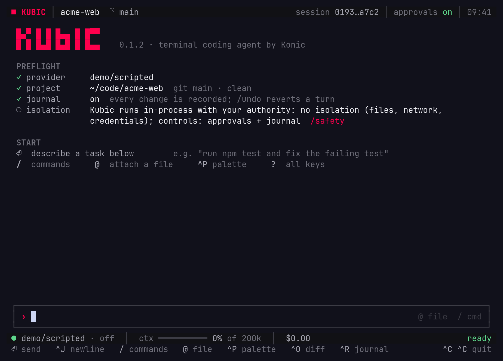
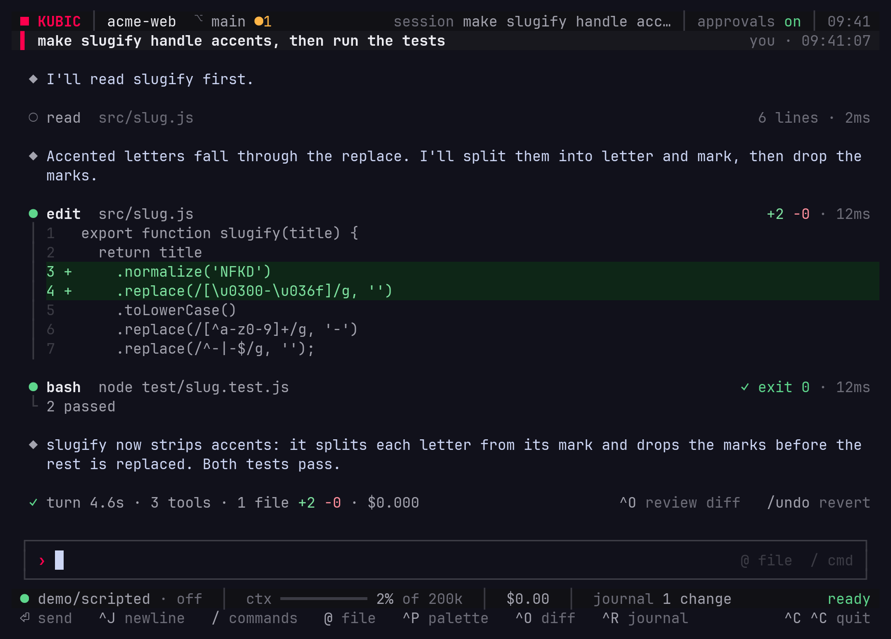
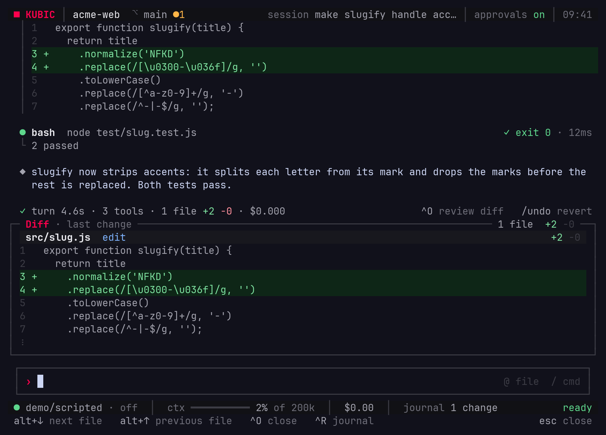
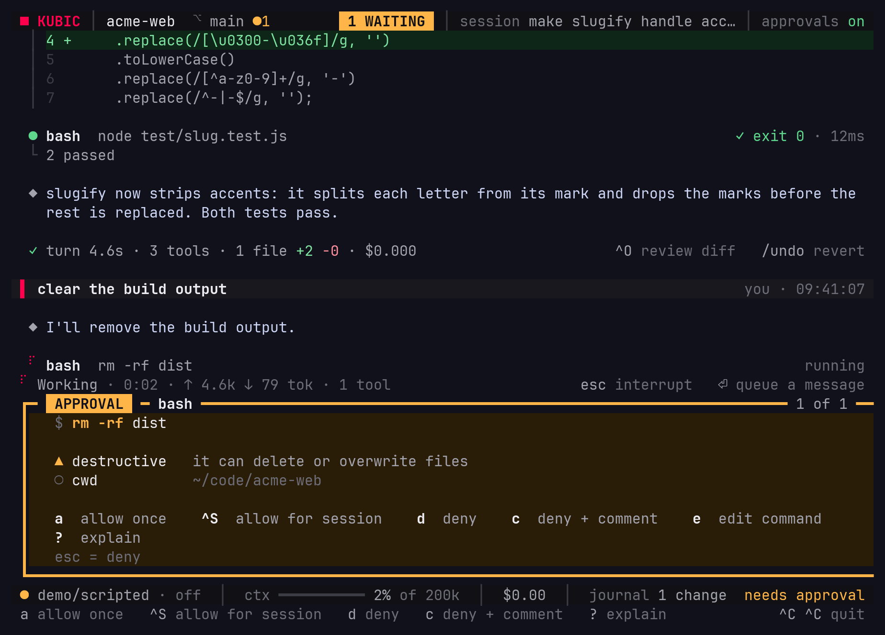
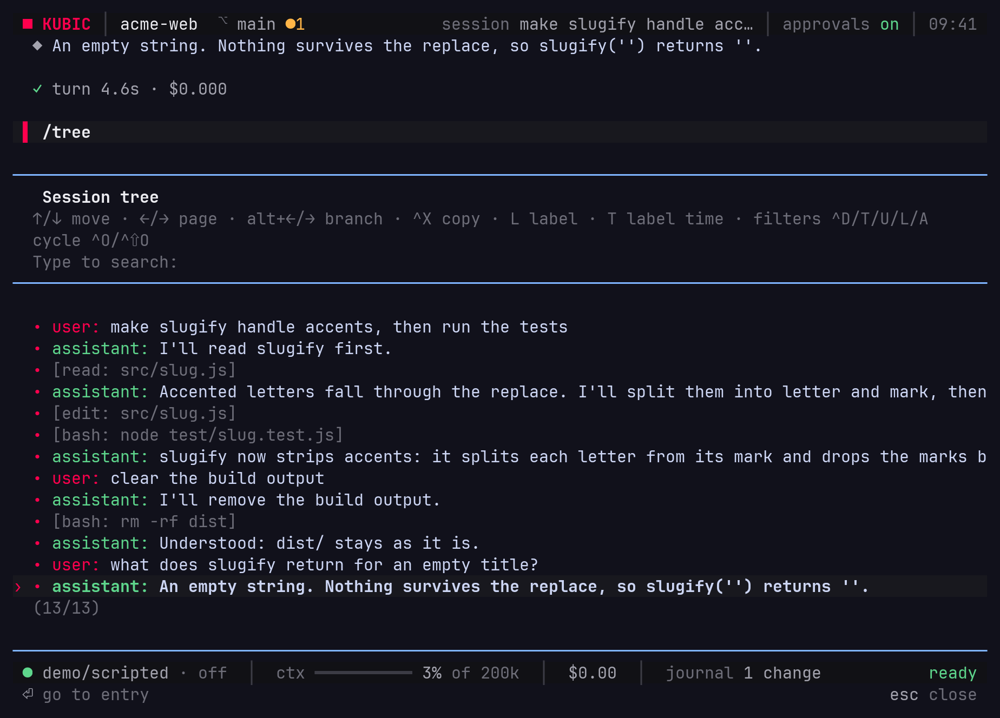

# Getting started

> Install Kubic, connect a model, run a first task, review and undo it, and
> come back to the session later.

## Install

Kubic needs Node 22.19 or later:

```sh
npm install -g kubic
kubic --version
```

`kubic --version` prints the version, and `npx kubic` runs Kubic without
installing it. On Windows, the `bash` tool needs Git Bash (Git for Windows) or
WSL. To build Kubic from source instead, see
[contributing](contributing.md#getting-set-up).

## Connect a model

Kubic reads provider keys from the environment, or from your system keychain
with `kubic keys set <provider>`:

```sh
export ANTHROPIC_API_KEY=...    # or OPENAI_API_KEY, GEMINI_API_KEY, OPENROUTER_API_KEY, ...
kubic setup                     # choose a default model
```

`kubic setup` saves the default to `~/.kubic/config.toml`, and a bare `kubic`
runs it for you on the first launch. `kubic models` lists what each configured
provider offers. A local or self-hosted model joins through an
OpenAI-compatible endpoint in `models.json`: see
[models and providers](cli/models.md).

To look around without a key, `KUBIC_PROVIDER=faux kubic` opens the TUI on a
built-in model that echoes your prompts.

## Run a first task

Open the TUI in your project:

```sh
cd ~/code/your-project
kubic
```

<picture>
  <source srcset="assets/tui/first-screen.svg" type="image/svg+xml">
  
</picture>

The first screen checks what a session needs: the model, the project, the
journal, and the isolation you have. There is none: Kubic acts with your
authority, which is why it asks before risky actions and journals every change.
Describe a task in the editor and press `Enter`.

<picture>
  <source srcset="assets/tui/session.svg" type="image/svg+xml">
  
</picture>

Each tool call shows as a card: the file read, the diff of each edit, the
command run and its exit status. The line under the turn sums it up: time,
tools, files changed and cost.

## Review and undo

`Ctrl+O` opens the diff panel on the last change, and `Ctrl+R` opens the
journal: every change of the session, file by file.

<picture>
  <source srcset="assets/tui/diff-panel.svg" type="image/svg+xml">
  
</picture>

Type `/undo` to put back the files the last turn changed. The same record is
there from a shell, with or without git:

```sh
kubic diff      # what the latest session in this directory changed
kubic undo      # put those files back
kubic log       # each journaled change
```

The journal is an undo log, not a backup: it restores files in the workspace,
not what a command changed elsewhere. See [journal commands](cli/journal.md).

## Approvals

Before the agent runs something destructive, reaches the network, writes
outside the workspace or touches credentials, Kubic stops and asks:

<picture>
  <source srcset="assets/tui/approval-card.svg" type="image/svg+xml">
  
</picture>

`a` allows it once, `Ctrl+S` allows it for the session, and `d` or `Esc`
denies it. `?` asks the model to explain the call. See
[approvals](cli/approvals.md) for what asks and why.

## Come back later

Every session is kept under `~/.kubic/sessions/`. `kubic sessions` lists them,
and `kubic resume <id>` opens one in the TUI again.

In the TUI, `/tree` shows the session as a tree. Pick an earlier prompt, edit
it and send it: the new branch sits beside the old one, and you can move
between them.

<picture>
  <source srcset="assets/tui/session-tree.svg" type="image/svg+xml">
  
</picture>

## Next

- [The TUI](cli/tui.md): the screen, the panels and the slash commands.
- [TUI keys](cli/tui-keys.md): every key, and how to rebind them.
- [Configuration](cli/configuration.md): config layers and keys.
- [For teams](cli/enterprise.md): managed policy, audit, spend caps and the sandbox.
- `kubic doctor` checks the setup and states the limits: see
  [doctor and debug](cli/doctor-and-debug.md).
